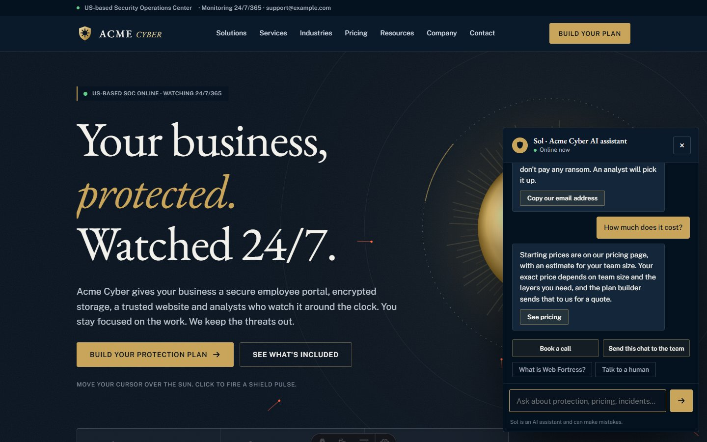

# Sol: a grounded AI assistant for a B2B website

Sol is the website assistant for a cybersecurity firm's site. It answers visitors' questions with Claude and hands them off to a person when they're ready. The site is built with Astro: pages are prerendered to static HTML, and two small server routes handle the chat (`/api/chat`) and the contact form (`/api/contact`).

> This started as a site I built for a client. It's published here with a made-up brand ("Acme Cyber"), placeholder contact details and sample testimonials.



## How Sol works

| Concern | How it's handled | Where |
|---|---|---|
| **Grounding** | The system prompt is built from the same data file that renders the pages, so Sol and the site can never disagree. Sol is told it has the full list and must not invent products, prices, clients, statistics or guarantees. Anything it doesn't know goes to the contact email. | [`src/pages/api/chat.js`](src/pages/api/chat.js), [`src/data/site.js`](src/data/site.js) |
| **Streaming** | The Anthropic SDK stream is passed to the browser as plain text through a `ReadableStream`. The server waits for the first event before replying, so a bad key or network error becomes a clean `503` rather than a broken stream. | `api/chat.js` |
| **Never goes dead** | On a `503`, the widget switches to an offline intent router with written answers. The site still answers questions with no API key at all. | [`src/scripts/intents.js`](src/scripts/intents.js), [`src/scripts/chat.js`](src/scripts/chat.js) |
| **Stop reasons** | A `refusal` or `max_tokens` stop ends with a short line that points the visitor to the team, instead of stopping mid-sentence. | `api/chat.js` |
| **Abuse and cost** | The server checks the transcript: roles must alternate, at most 20 turns, at most 1,000 characters per message. Each IP is rate limited (chat 20 per 10 minutes, contact 5 per 10 minutes). Replies are capped at 1,024 tokens at low effort, with a server-side fallback model. | [`src/lib/server.js`](src/lib/server.js) |
| **Safety** | Possible incidents get immediate triage steps: disconnect the device without powering it off, don't pay the ransom, email with URGENT in the subject. Sol declines offensive-security requests and offers defensive help instead. | system prompt |
| **Handoff to a person** | "Send this chat to the team" opens the contact form with the visitor's questions already filled in. | `chat.js` |

The rest of the site uses the same data file: a protection-plan builder, a 15-question cyber-insurance readiness score, industry pages and Markdown articles.

## Run it

```bash
npm install
cp .env.example .env   # optional: add ANTHROPIC_API_KEY for live answers
npm run dev            # http://localhost:4321
npm run check          # self-checks: intent routing, plan logic, transcript validation, readiness scoring
npm run build && node dist/server/entry.mjs   # production
```

| Variable | What it does | Without it |
|---|---|---|
| `ANTHROPIC_API_KEY` | Sol answers with Claude | Sol uses its built-in answers |
| `RESEND_API_KEY`, `CONTACT_TO`, `CONTACT_FROM` | The contact form sends email through Resend | The form asks visitors to email directly |

## Deploy

Works on any Node host (Render blueprint included in `render.yaml`). For Vercel or Netlify, swap the adapter in `astro.config.mjs`. Keys go in the host's environment variables, never in code.

Comments marked `Known limit:` name each simplification on purpose (for example, the per-instance rate limiter) and how to upgrade it.
